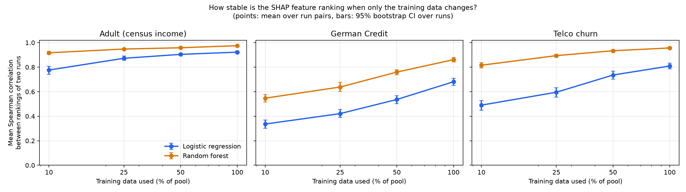
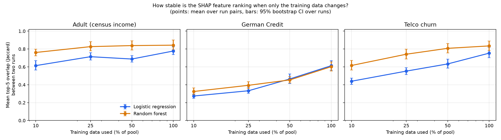
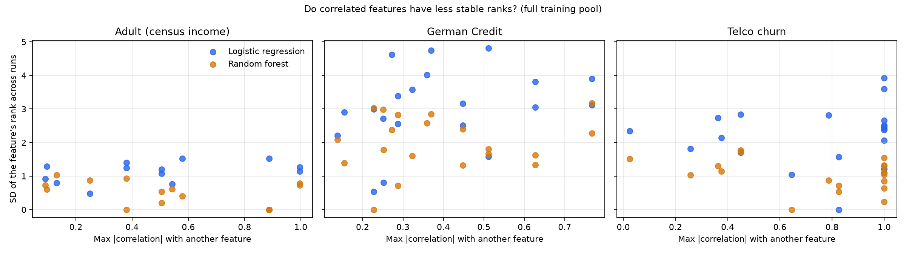

# shap-stability

**How stable are SHAP explanations when only the training data changes?**

A reproducible study on three public tabular datasets. For a logistic regression and a random
forest, I retrain the model many times on resampled training data, explain the *same* rows each
time, and measure how much the SHAP feature ranking moves.



## TL;DR

I had three guesses before looking at the data. The data disagreed with two of them.

| # | Guess | Verdict |
|---|---|---|
| 1 | The linear model's explanations will be very stable | **Not supported.** By rank correlation, logistic regression was *less* stable than the random forest on all three datasets and at every training size. By top-5 overlap the same holds on Adult and Telco, while on German Credit the two models are indistinguishable at 50% and 100% of the data. |
| 2 | The random forest will be less stable, especially with correlated features | **Not supported.** The forest was more stable, and rank variability was only weakly and inconsistently related to feature correlation. |
| 3 | More training data makes explanations more stable | **Supported** for both models on all datasets. |

Stability is not guaranteed even with the full training pool: the mean overlap of the top-5
features between two retrainings is 0.60 to 0.84 (Jaccard), depending on dataset and model.

## Research question

When the training sample changes (bootstrap resamples of different sizes, different random
seeds), do the SHAP feature rankings stay the same? Does the answer differ between a linear
model and a tree ensemble?

## Method

- **Datasets** (binary classification): UCI *Adult* (census income, stratified subsample of
  10,000 rows), *German Credit* (1,000 rows), IBM *Telco Customer Churn* (7,043 rows).
- **Models:** logistic regression (L2, `class_weight="balanced"`) and random forest (200 trees,
  `min_samples_leaf=5`, `class_weight="balanced"`), default-ish settings, not tuned.
- **Fixed holdout:** 20% of each dataset is set aside once (stratified). Up to 500 of those rows
  are explained in every run, so any change in explanations comes from the training data, not
  from explaining different rows.
- **Runs:** for each model and training fraction (10%, 25%, 50%, 100% of the remaining pool),
  50 bootstrap resamples; the model is refit (including preprocessing) and explained with SHAP
  (`LinearExplainer` for the linear model, `TreeExplainer` for the forest).
- **Importance per feature:** mean |SHAP| over the explained rows. One-hot columns of the same
  original feature are summed *per row* (signed) before taking the absolute value, so each
  original feature is compared as a whole.
- **Stability metrics**, over all pairs of runs: Spearman correlation between the two feature
  rankings, and Jaccard overlap of the top-5 features. 95% confidence intervals come from a
  bootstrap over *runs* (resampling runs with replacement and dropping pairs made of the same
  run twice).
- **Correlation analysis:** for each feature, its highest absolute correlation with any column
  of another feature, compared with the standard deviation of its rank across runs.

## Results

Mean Spearman correlation between the rankings of two runs (95% CI), by training size:

| Dataset | Model | 10% | 25% | 50% | 100% |
|---|---|---|---|---|---|
| Adult | Logistic regression | 0.777 | 0.873 | 0.905 | 0.923 |
| Adult | Random forest | 0.918 | 0.948 | 0.959 | 0.975 |
| German Credit | Logistic regression | 0.336 | 0.421 | 0.537 | 0.681 |
| German Credit | Random forest | 0.547 | 0.638 | 0.760 | 0.861 |
| Telco churn | Logistic regression | 0.491 | 0.596 | 0.736 | 0.810 |
| Telco churn | Random forest | 0.816 | 0.894 | 0.934 | 0.957 |

Confidence intervals, top-5 overlap and holdout AUC for every cell are in
[`results/summary.md`](results/summary.md) and `results/stability_summary.csv`.
Spearman intervals for the two models do not overlap in any cell of the table above. For the
top-5 overlap the picture is less clear-cut: the forest is clearly ahead on Adult and Telco, but
on German Credit the intervals overlap at 50% and 100% of the data (0.465 vs 0.454 and 0.613 vs
0.602), so the two models cannot be told apart there.



### What the correlation analysis shows

Across the 24 combinations (3 datasets x 2 models x 4 sizes), the Spearman correlation between a
feature's maximum correlation with other features and the spread of its rank is small and has no
consistent sign. Only German Credit with logistic regression is positive and nominally
significant at 25% and 100% of the data (rho = 0.55, p = 0.012; rho = 0.45, p = 0.044). With 24
tests and 14 to 20 features each, that is weak evidence and I would not rely on it.
See [`results/corr_vs_instability.csv`](results/corr_vs_instability.csv).



### A possible explanation (exploratory, not tested)

At the full training size, the logistic regression's mean importances are much more closely
spaced among the top features than the forest's. For example on Adult, the smallest relative gap
between consecutive importances among the top 8 features is 0.001 for the linear model and 0.073
for the forest. Closely spaced importances are easy to reorder by chance. This pattern is not
uniform across datasets (the concentration of importance on Telco points the other way), so
treat it as a hypothesis for follow-up, not a finding.

## Limitations

- **Three datasets and two models.** Results may not transfer to other data, other models
  (e.g. gradient boosting), or tuned hyperparameters.
- **Rankings, not correctness.** A stable explanation is not necessarily a faithful or causal one.
- **Bootstrap resampling** duplicates rows and slightly changes the data distribution; the
  100% setting is a bootstrap of the full pool, not the original sample.
- **Rank metrics depend on the number of features.** Tail features with near-zero importance
  add noise to Spearman; the top-5 overlap is less affected by that.
- **Correlation analysis is crude.** Some one-hot columns are perfect duplicates of each other
  (for example the "No internet service" columns in Telco), which makes the maximum correlation
  1.0 for many features. It also does not separate shared credit among correlated features from
  genuine instability.
- **Adult is subsampled** to 10,000 rows for runtime; explanations use at most 500 holdout rows.

## Reproduce

```bash
python -m venv venv && source venv/bin/activate
pip install -r requirements.txt
pytest -q
python experiments/run_stability.py --repeats 50   # about 13 minutes on a laptop
python experiments/analyze.py                      # tables and figures in results/
```

Adult and German Credit are downloaded from OpenML on first use. The Telco CSV is not
redistributed: [download it](https://www.kaggle.com/datasets/blastchar/telco-customer-churn) to
`data/WA_Fn-UseC_-_Telco_Customer_Churn.csv`, or skip it with `--datasets adult german_credit`.

## Structure

```
src/shapstab/      data loading, models, stability metrics
experiments/       run_stability.py (trains and explains), analyze.py (statistics and figures)
tests/             unit tests for the metrics
results/           raw per-run importances, summary tables and figures
assets/            diagram used in the project write-up
```

## License

MIT
